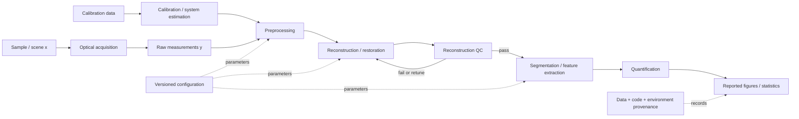
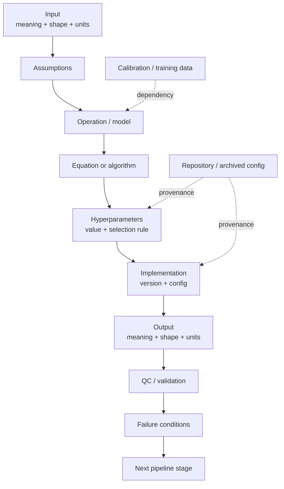

# Writing Standards for Image-Processing Pipelines in Computational Microscopy Theses and Papers

## Executive summary

A strong computational-microscopy pipeline section should do more than state that images were “preprocessed, reconstructed, and analyzed.” It should make the entire transformation from **physical measurement to reported result auditable**: what enters each stage, what leaves it, which transformation is applied, what assumptions the transformation makes, which parameters control it, how those parameters were chosen, how the implementation can be recovered, and how correctness was checked. This conclusion is strongly supported both by exemplary computational-imaging papers—which explicitly connect forward models, inverse problems, algorithms, parameters, and validation—and by the QUAREP-LiMi reporting guidelines for image-analysis workflows. citeturn19view3turn20view1turn20view2

The most useful concrete standard for a thesis is therefore a **two-level description**:

1. A **global pipeline overview** gives the ordered data flow, important feedback loops, calibration dependencies, and the point at which raw measurements become derived images and quantitative results. QUAREP-LiMi explicitly recommends describing the workflow sequence and identifies a flowchart as the preferred representation for a new image-analysis workflow. citeturn20view1
2. Every substantive stage then follows the **same local schema**: *purpose → inputs → operation/equations → parameters → implementation → output → validation/failure conditions*. Papers such as Kellman et al. are especially effective because their prose, equations, algorithm pseudocode, and experimental figures all use the same conceptual objects and symbols. citeturn19view3

The proposed thesis standard in this report can be summarized as follows:

| Component | Recommended thesis standard |
|---|---|
| Pipeline overview | One figure near the start of the section, showing acquisition/calibration, processing stages, outputs, branches, learned components, and QC paths. |
| Stage description | Give objective; typed/dimensioned input and output; exact transformation; assumptions; parameters; implementation; QC; failure modes. |
| Mathematical formulation | State the physical forward model first when relevant; formulate the inverse problem or transformation second; give update equations only if they clarify implementation. |
| Hyperparameters | Centralize them in a table. Distinguish **physical/acquisition**, **algorithmic**, **learned/training**, **numerical**, **evaluation**, and **display-only** parameters. |
| Notation | Use one symbol for one concept throughout the chapter. Give shapes/units at first occurrence. Maintain a notation table for repeatedly used nontrivial symbols. |
| Figures | Use an overview flowchart, a system/forward-model schematic where physics matters, intermediate before/after images, QC/residual figures, and sensitivity/ablation plots where parameter choice is consequential. |
| Captions | Make them interpretable without hunting through the prose: identify every panel and annotation, data/sample, scale, display processing, and the substantive comparison or takeaway. |
| Reproducibility | Record exact code version/commit, configuration, data identifiers, preprocessing order, dependencies/environment, hardware where consequential, model weights, data splits, randomness/seeds, and commands. |
| Supplement/appendix | Put exhaustive parameter inventories, environment/package listings, full configuration files, extra validation, and secondary sensitivity analyses here—not essential information needed to understand the main algorithm. |

This standard is deliberately stricter than the minimum seen in many papers. QUAREP-LiMi distinguishes **minimal, recommended, and ideal** reporting levels; for a thesis, the extra space makes it reasonable to target something close to the recommended/ideal level rather than journal-minimum reporting. Its guidance specifically calls for workflow/component versions, key settings, example data and code, machine-learning metadata and hyperparameters, limitations, and—ideally—containers or similarly executable environments. citeturn19view1turn20view0turn20view1turn20view2

A useful test is:

> **Could a technically competent reader reconstruct not merely the conceptual algorithm, but the exact sequence of transformations that produced a representative thesis figure?**

If the answer is no, the methods description is not yet complete. QUAREP-LiMi's guidance is particularly strong on this point: manually selected ROIs should be shared, important processing should be disclosed, exact software versions should be identified, and original and processed images should be made available where possible. citeturn20view0turn21view0turn21view1


## Curated exemplary corpus

The following shortlist is intentionally mixed. The theses demonstrate how to sustain notation and methodological narrative over a chapter; the microscopy papers demonstrate compact paper-level exposition; the computer-vision papers show particularly effective algorithmic descriptions; and the QUAREP-LiMi paper is included because it is the clearest recent microscopy-specific reporting benchmark. The corpus is concentrated in 2018–2024, with the selected theses from Berkeley repositories and papers from Nature Methods, Nature Communications, CVPR, MICCAI, Optica, and IEEE venues. citeturn9view0turn11search0turn11search1turn23search8turn23search3turn18search1turn17search5turn18search3

### Comparison of model documents

| Title | Authors | Year | Type | Venue | Primary source / OA status | Key strengths | Weaknesses as a writing model |
|---|---|---:|---|---|---|---|---|
| *Physics-based Learning for Large-scale Computational Imaging* | Michael Kellman | 2020 | PhD thesis | UC Berkeley EECS | [Berkeley EECS](https://www2.eecs.berkeley.edu/Pubs/TechRpts/2020/EECS-2020-167.html) — **OA** citeturn9view0turn1search4 | Excellent “physics first” organization: acquisition/forward process, inverse reconstruction, then joint or learned design; spans LED-array microscopy, MRI, and optical super-resolution. | Breadth across modalities means a reader adapting it to one microscope should use its organizational logic, not its chapter scale. |
| *Robust 3D Quantitative Phase Imaging* | Regina Eckert | 2022 technical-report version; dissertation associated with 2021 | PhD thesis | UC Berkeley EECS | [Berkeley EECS](https://www2.eecs.berkeley.edu/Pubs/TechRpts/2022/EECS-2022-29.html) — **OA** citeturn11search0turn11search4 | Strong example of organizing methods around practical failure modes and remedies: self-calibration, measurement diversity, and physics-based learning, with concrete FPM/ODT systems. | Not one single linear pipeline; methods are organized around several frameworks. |
| *Computational fluorescence and phase super-resolution microscopy* | Li-Hao Yeh | 2019 | PhD thesis | UC Berkeley | [UC eScholarship](https://escholarship.org/uc/item/02p6h805) — **OA** citeturn11search1turn11search7 | Particularly relevant for connecting optical acquisition design to computational reconstruction and optimization rather than treating “image processing” independently from imaging physics. | Broad dissertation scope; a thesis reader must still consolidate chapter-specific implementation choices into a global parameter ledger. |
| *Content-aware image restoration: pushing the limits of fluorescence microscopy* | Martin Weigert et al. | 2018 | Peer-reviewed paper | *Nature Methods* | [Nature Methods](https://www.nature.com/articles/s41592-018-0216-7); open preprint available — publisher access may vary. citeturn15view0turn6search20 | Excellent task-oriented figures; multiple microscopy restoration examples; explicit availability of implementations in Python/Fiji/KNIME; clear relation between corrupted input, learned transformation, and output. | Because it demonstrates many applications, some application-specific implementation detail naturally lives outside the main narrative. |
| *Noise2Void—Learning Denoising from Single Noisy Images* | Alexander Krull, Tim-Oliver Buchholz, Florian Jug | 2019 | Peer-reviewed conference paper | CVPR | [CVF Open Access](https://openaccess.thecvf.com/content_CVPR_2019/html/Krull_Noise2Void_-_Learning_Denoising_From_Single_Noisy_Images_CVPR_2019_paper.html) — **OA** citeturn6search1turn6search5 | Exceptionally concise statement of assumptions, learning setup, and the distinction between available noisy data and unavailable clean targets; strong model for explaining why a processing strategy is valid. | Primarily a denoising/learning paper rather than an end-to-end optical-imaging-system description. |
| *Cellpose: a generalist algorithm for cellular segmentation* | Carsen Stringer, Tim Wang, Michalis Michaelos, Marius Pachitariu | 2021 | Peer-reviewed paper | *Nature Methods* 18, 100–106 | [Nature Methods](https://www.nature.com/articles/s41592-020-01018-x); code/data openly available. citeturn23search8turn23search2turn23search5 | Clear architecture-to-output narrative, diverse test imagery, direct visual segmentation comparisons, public software and datasets. | Cellpose software has evolved substantially since the 2021 article; a reproducible thesis must name the exact historical/current release and weights rather than citing “Cellpose” alone. citeturn23search20turn23search5 |
| *Cell Detection with Star-Convex Polygons* | Uwe Schmidt, Martin Weigert, Coleman Broaddus, Gene Myers | 2018 | Peer-reviewed conference paper | MICCAI 2018 | [Springer](https://link.springer.com/chapter/10.1007/978-3-030-00934-2_30); [OA arXiv version](https://arxiv.org/abs/1806.03535). citeturn23search3turn23search6 | Exemplary compact geometric representation: object assumption → polygon parameterization → CNN prediction → instance extraction; notation and conceptual figure align closely. | Conference-page limits necessarily constrain exhaustive environment and hyperparameter reporting; use the code/preprint alongside it for implementation. citeturn23search9 |
| *Deep-STORM: super-resolution single-molecule microscopy by deep learning* | Elias Nehme, Lucien E. Weiss, Tomer Michaeli, Yoav Shechtman | 2018 | Peer-reviewed paper | *Optica* 5(4), 458–464 | [Optica](https://opg.optica.org/abstract.cfm?uri=optica-5-4-458); [OA author version](https://arxiv.org/abs/1801.09631); official implementation available. citeturn18search1turn18search4turn18search12 | Very clear computational-microscopy story: simulated/experimental training data → CNN → reconstructed localization image → experimental validation. | The term “parameter-free” concerns use of the trained inference method; it should not be copied as shorthand for “no methodological choices”—simulation, training, normalization, architecture, and acquisition still require specification. citeturn18search4 |
| *Memory-Efficient Learning for Large-Scale Computational Imaging* | Michael Kellman, Kevin Zhang, Eric Markley, Jon Tamir, Emrah Bostan, Michael Lustig, Laura Waller | 2020 | Peer-reviewed paper | *IEEE Transactions on Computational Imaging* 6, 1403–1414 | [IEEE](https://ieeexplore.ieee.org/document/9204455); [OA author version](https://arxiv.org/abs/2003.05551). citeturn17search5turn17search1 | Perhaps the strongest exemplar here for linking forward model → inverse objective → iterative updates → unrolled network → pseudocode → complexity → explicit experimental parameters → qualitative and quantitative comparison. citeturn19view3 | The shorter workshop/preprint and final IEEE versions differ in presentation/authorship details; cite and reproduce against the exact version actually used. |
| *Democratising deep learning for microscopy with ZeroCostDL4Mic* | Lucas von Chamier et al. | 2021 | Peer-reviewed paper | *Nature Communications* 12, 2276 | [Nature Communications](https://www.nature.com/articles/s41467-021-22518-0) — **OA** citeturn23search1turn16view0 | Outstanding reporting example: workflow overview, training/QC/prediction structure, supplementary parameter tables, explicit compute considerations, training/validation diagnostics, and example figures that show data, predictions, metrics, and settings together. citeturn16view0 | It is a platform paper covering many network families; detailed parameterization is necessarily distributed among notebooks and supplements. |
| *Community-developed checklists for publishing images and image analyses* | Christopher Schmied et al. | 2024 | Peer-reviewed reporting paper/guideline | *Nature Methods* 21, 170–181 | [Nature Methods](https://www.nature.com/articles/s41592-023-01987-9); [living companion](https://quarep-limi.github.io/WG12_checklists_for_image_publishing/intro.html) — **OA resources available**. citeturn18search3turn18search6turn19view1 | The strongest standards reference: separates minimal, recommended, and ideal reporting; treats figures, established workflows, new workflows, ML workflows, settings, code/data, versions, limitations, and containers. | It is a reporting standard rather than an example of a continuous thesis-methods narrative, so it should govern completeness rather than prose style. |

### Annotated reading notes

**Kellman's thesis is the best dissertation-level model for a physics-led pipeline narrative.** Its scope explicitly treats acquisition and reconstruction as coupled parts of computational imaging rather than describing processing as an isolated post-acquisition activity. That is the right conceptual pattern for Fourier ptychography, phase retrieval, computational fluorescence imaging, deconvolution, tomography, and similar systems: establish how information is physically encoded before explaining how it is computationally decoded. citeturn9view0turn1search4

**Eckert's dissertation is especially useful when calibration is itself part of the pipeline.** Its framing around algorithmic self-calibration, measurement diversity, and physics-based machine learning shows a stronger thesis pattern than relegating calibration to a sentence such as “system parameters were calibrated beforehand.” Where aberrations, LED position, propagation distance, pupil functions, or other system parameters influence reconstruction, calibration should be a named computational stage with inputs, estimated quantities, validation, and propagation into subsequent equations. citeturn11search0

**Yeh's dissertation is a useful model for jointly presenting optical and computational super-resolution.** The central lesson for writing is that acquisition design, measurement characteristics, and optimization should share one vocabulary and one sequence rather than appear in disconnected “experimental” and “image processing” paragraphs. citeturn11search1turn11search7

**CARE is exemplary for explaining an image-restoration method through representative tasks and paired visual evidence.** The Nature Methods article presents multiple concrete fluorescence-microscopy restoration problems and makes its implementations available in common environments. For thesis writing, copy the visual logic—input, target/reference, result, relevant quantitative evidence—not merely the neural-network vocabulary. citeturn15view0

**Noise2Void is an unusually good model for writing an assumption-driven stage.** The essential question is posed before the machinery: how can a model learn restoration without paired clean targets? The paper's concise distinction between what data are and are not required provides a useful model for any pipeline stage whose validity depends on a statistical assumption. A thesis should explicitly say not just *what* a denoiser or estimator does, but *under what data/noise assumptions the operation is justified*. citeturn6search1turn6search9

**Cellpose demonstrates how an algorithm paper can connect a conceptual representation, architecture, heterogeneous dataset, and qualitative examples.** Its public software and dataset further make the published method operational rather than purely descriptive. Because the Cellpose package has subsequently changed, it also illustrates a reproducibility lesson: the citation identifies the scientific method, while a version/commit/weights identifier identifies the experiment you actually ran. citeturn23search8turn23search5turn23search20

**StarDist is a compact model of “representation before implementation.”** The paper first motivates star-convex polygons as a better object representation in crowded microscopy images and then explains what the network predicts for each pixel. This is preferable to opening a stage with layer counts or library calls: state the mathematical or geometric object being estimated first, then state how it is predicted. citeturn23search6turn23search3

**Deep-STORM shows how to write a learned reconstruction method as an imaging method rather than merely a neural network.** It identifies the microscopy phenomenon, training source, transformation, speed/precision objective, and both simulated and experimental validation. Its availability of an official implementation provides a natural bridge from conceptual description to reproducible implementation. citeturn18search4turn18search12

**Kellman et al.'s memory-efficient imaging paper is the strongest equation-to-algorithm example in the shortlist.** It defines the measurement model \(\mathbf y=\mathcal A(\mathbf x)+\mathbf n\), formulates reconstruction as an optimization problem, gives the proximal-gradient updates, defines layerwise symbols, presents pseudocode, states computational complexity, and later reports application-level settings such as checkpoint frequency alongside memory, run-time, and reconstruction comparisons. citeturn19view3

**ZeroCostDL4Mic is the strongest figure-and-QC model.** Its workflow covers data transfer, training, quality control, and prediction; its paper reports resource limitations and directs readers to supplementary parameter/training-time tables; and later figures combine training curves, prediction imagery, error/SSIM maps, segmentation metrics, and concrete settings such as epoch and patch parameters. That is close to the visual standard a thesis methods/results bridge should aim for. citeturn16view0turn23search1

**Schmied et al./QUAREP-LiMi should be treated as the completeness benchmark.** Their living companion says new workflows should identify components and versions, describe sequence, report key settings—preferably in a table—provide example data and code, disclose limitations, and ideally make execution easy through a container or comparable packaged environment. For ML workflows, it additionally calls for accessible models, validation data, training/testing data and metadata, code, and limitations. citeturn20view1turn20view2


## Derived writing standard for a computational-microscopy pipeline

### The global pipeline should precede the details

Start the pipeline section with a short orienting paragraph that tells the reader:

> what the raw measurement is, what the final scientific output is, what the major transformations between them are, and which steps depend on calibration, learned parameters, or manual decisions.

Then place an overview diagram immediately after that paragraph. QUAREP-LiMi recommends an explicit description of sequence and calls a flowchart the best format for a new workflow; ZeroCostDL4Mic similarly uses an overview to orient readers before detailed processing steps. citeturn20view1turn16view0

For a computational microscope, a robust top-level structure is:



Do **not** make this diagram decorative. Every block should correspond either to a subsection, a deliberately trivial operation stated in prose, or a clearly referenced external method. If “background correction” appears in the flowchart, the thesis must eventually say how that background is estimated, with which settings, and whether it operates on raw intensity, calibrated intensity, or reconstructed images. This follows QUAREP-LiMi's principle that sequence and key settings must be recoverable, including settings that may otherwise be hidden in software defaults. citeturn20view0turn20view1

### Use a fixed local schema for every major stage

A thesis becomes dramatically easier to audit when each stage answers the same questions in the same order. The following is the recommended standard:

| Stage element | What the prose must answer | Example |
|---|---|---|
| **Purpose** | Why does this stage exist? Which error/information deficit does it address? | “Registration compensates inter-frame sample drift before phase retrieval.” |
| **Input** | What object enters? Shape, datatype, units, calibration state? | \(Y\in\mathbb R^{N\times H\times W}\), camera counts, dark-subtracted. |
| **Operation** | Exactly what transformation is applied, in what order? | Flat-field → clipping → registration → normalization. |
| **Formulation** | What equation/objective defines the operation? | \(\hat x=\arg\min_x D(A_\theta x,y)+\lambda R(x)\). |
| **Parameters** | Which values influence the result, and how were they selected? | Gaussian \(\sigma=1.2\) px; \(\lambda=5\times10^{-3}\), selected on validation data. |
| **Implementation** | What code/package/version/precision/hardware is materially relevant? | Package vX.Y; commit; float32; GPU model. |
| **Output** | What exactly leaves the stage? Same shape? Changed units? Mask? complex field? | Complex field \(\hat x\in\mathbb C^{H'\times W'}\). |
| **QC and limitations** | How do you detect failure, and what conditions violate assumptions? | Residual criterion; registration-error threshold; saturation exclusion. |

This schema combines the equation-first clarity seen in computational-imaging work with QUAREP-LiMi's requirements for sequence, settings, components, examples, and limitations. citeturn19view3turn20view1turn20view2

A useful writing rule is **one causal statement per processing decision**. Do not write:

> “The images were Gaussian-filtered and thresholded.”

Prefer:

> “To suppress pixel-scale shot-noise fluctuations before object detection, we convolved each dark-corrected frame with a Gaussian kernel of standard deviation \(\sigma=1.2\) px. We then binarized the smoothed image using threshold \(\tau=0.18\) in normalized-intensity units. Values of \(\sigma\) and \(\tau\) were fixed from the validation set and were not re-estimated on test images.”

The second version records purpose, order, units, parameters, and selection policy. QUAREP-LiMi explicitly gives Gaussian-blur sigma and thresholding algorithm as examples of “key settings” that should be reported and recommends a separate table for them. citeturn20view1

### Separate five kinds of parameters

One of the most common causes of unreadable methods sections is using the word **parameter** for fundamentally different things. Your thesis should explicitly classify them.

**Physical/acquisition parameters** include wavelength, numerical aperture, exposure, camera gain, pixel pitch, illumination geometry, axial spacing, PSF calibration, and propagation distance. These determine the forward model.

**Algorithmic hyperparameters** include regularization weights, thresholds, filter widths, connectivity, number of rays in StarDist-like methods, tile overlap, and interpolation method.

**Numerical parameters** include number of iterations, convergence tolerance, step size, solver, initialization, floating-point precision, and boundary handling. Kellman et al., for example, expose the gradient step and iteration-dependent quantities directly in their mathematical description rather than leaving the solver implicit. citeturn19view3

**Learned-model parameters and training hyperparameters** should be distinguished. Learned weights \(\omega\) are not the same thing as learning rate, batch size, optimizer, augmentation, patch size, epochs, or loss weights. QUAREP-LiMi recommends making training/test data and associated metadata—including hyperparameters, configuration, training time, and computing resources—available for ML workflows. citeturn20view2

**Display/evaluation parameters** include contrast limits, LUT, gamma, projection method, interpolation used only for display, metric definitions, matching thresholds, and ROI-selection policy. These should never silently masquerade as scientific preprocessing. QUAREP-LiMi recommends disclosing non-linear post-processing such as median filtering, deconvolution, reconstruction, and inverted LUTs in figure legends, while keeping the more general acquisition information in Methods. citeturn21view0

### Write equations in layers of increasing detail

The best computational-imaging papers do not begin with implementation minutiae. They establish the conceptual mathematics first. Kellman et al., for example, introduce a general forward model and inverse objective before writing the iterative update and then the unrolled-network representation. citeturn19view3

A thesis can use the same hierarchy.

**Measurement/forward model**

\[
\mathbf y = \mathcal A_{\boldsymbol\theta}(\mathbf x)+\mathbf n ,
\]

where \(\mathbf x\) is the latent object, \(\mathbf y\) the acquired measurements, \(\mathcal A_{\boldsymbol\theta}\) the imaging operator parameterized by calibrated physical quantities \(\boldsymbol\theta\), and \(\mathbf n\) measurement noise. This structure closely matches the general formulation used in Kellman et al. citeturn19view3

**Inverse/reconstruction problem**

\[
\hat{\mathbf x}
=
\arg\min_{\mathbf x}
\left[
\mathcal D\!\left(\mathcal A_{\boldsymbol\theta}(\mathbf x),\mathbf y\right)
+
\lambda\,\mathcal R(\mathbf x)
\right],
\]

with \(\mathcal D\) the data-fidelity term, \(\mathcal R\) a prior/regularizer, and \(\lambda\) the regularization weight. This makes immediately visible which choices are physical and which are algorithmic. citeturn19view3

**Generic processing stage**

\[
\mathbf z^{(k)}
=
f_k\!\left(
\mathbf z^{(k-1)};\boldsymbol\phi_k
\right),
\qquad
k=1,\ldots,K,
\]

where \(f_k\) is stage \(k\) and \(\boldsymbol\phi_k\) contains its fixed algorithmic settings. This notation is particularly useful when the thesis contains preprocessing stages that are not themselves inverse problems.

**Learned reconstruction**

\[
\hat{\mathbf x}=f_{\boldsymbol\omega}(\mathbf y),
\]

\[
\boldsymbol\omega^\star
=
\arg\min_{\boldsymbol\omega}
\frac{1}{N}
\sum_{i=1}^{N}
\ell\!\left(
f_{\boldsymbol\omega}(\mathbf y_i),\mathbf x_i^{\mathrm{target}}
\right).
\]

Then state the data construction, normalization, augmentation, loss, optimizer, learning-rate policy, stopping/model-selection rule, and inference procedure in prose or a parameter table. The ML reporting guidance specifically calls for access to models, example/validation data, training/test metadata, code, and limitations. citeturn20view2

For an iterative method, include the update rule only when it resolves ambiguity. Kellman et al.'s proximal-gradient exposition is a good example:

\[
\mathbf z^{(k)}
=
\mathbf x^{(k)}
-\alpha\nabla_{\mathbf x}\mathcal D(\mathbf x^{(k)};\mathbf y),
\]

\[
\mathbf x^{(k+1)}
=
\operatorname{prox}_{\mathcal P}\!\left(\mathbf z^{(k)}\right).
\]

They immediately define \(\alpha\), the gradient, proximal operator, and iteration variables, then connect the equations to the network interpretation. citeturn19view3

The writing principle is: **an equation should remove ambiguity that prose would otherwise leave**. Do not write equations merely to make the section look rigorous.

### Recommended notation policy

Adopt a small number of semantic conventions and never violate them within the chapter:

| Notation class | Recommended convention | Example |
|---|---|---|
| Scalars | lowercase Greek/Roman | \(\lambda,\alpha,\sigma,N\) |
| Vectors/images | bold lowercase | \(\mathbf x,\mathbf y,\mathbf z\) |
| Matrices | bold uppercase where genuinely matrix-valued | \(\mathbf H\) |
| Operators | calligraphic uppercase | \(\mathcal A,\mathcal F\) |
| Objective/loss | \(\mathcal L,\mathcal D,\mathcal R\) | data fidelity / regularizer |
| Physical/calibration parameters | \(\boldsymbol\theta\) | aberration coefficients, geometry |
| Fixed algorithmic parameters | \(\boldsymbol\phi\) | thresholds, filter widths |
| Learned weights | \(\boldsymbol\omega\) | CNN weights |
| Iteration/stage | superscript \((k)\) | \(\mathbf x^{(k)}\) |
| Estimate | hat | \(\hat{\mathbf x}\) |
| Optimizer solution | star when needed | \(\mathbf x^\star\) |

This exact symbol assignment is a **house standard**, not a universal requirement. Its value is that physical parameters, manually chosen hyperparameters, and learned weights cannot accidentally be conflated. Kellman et al. illustrate the broader principle well by defining forward-model, data-fidelity, prior, step-size, and iteration symbols immediately alongside the equations that use them. citeturn19view3

State dimensions and units at first occurrence:

> “Let \(\mathbf y\in\mathbb R^{N_\mathrm{ill}\times H\times W}\) denote the stack of \(N_\mathrm{ill}=16\) raw intensity measurements, with lateral sampling \(p=0.325\,\mu\mathrm m\) per pixel.”

This is substantially better than forcing the reader to reconstruct image dimensions and units from the hardware section.


## Figures, captions, parameter tables, and visual grammar

### Use different figure types for different questions

No single “pipeline figure” can do all of the work. The strongest papers in the corpus use distinct visual forms for conceptual architecture, representative imagery, and quantitative evaluation: Kellman et al. combine algorithmic exposition with reconstruction/loss comparisons; ZeroCostDL4Mic uses workflow diagrams plus training/QC figures; Cellpose and StarDist use architecture/representation figures alongside diverse segmentation examples. citeturn19view3turn16view0turn23search8turn23search6

A thesis methods chapter should normally contain the following visual roles:

| Figure type | Question it answers | Include when |
|---|---|---|
| **Pipeline flowchart** | “What happens, and in what order?” | Almost always. |
| **Optical/forward-model schematic** | “How does the specimen become the measurement?” | Computational imaging, phase retrieval, tomography, deconvolution with calibrated PSF, coded illumination. |
| **Algorithm block diagram** | “How do internal computational modules interact?” | Learned reconstruction, multi-branch processing, recurrent/iterative methods. |
| **Algorithm pseudocode** | “What exactly loops, branches, updates, or terminates?” | Iterative algorithms or logic that prose/equations alone do not fully specify. |
| **Intermediate-image strip** | “What does each stage actually do?” | Multi-stage preprocessing/reconstruction. |
| **Residual/QC figure** | “How do we know the result is credible?” | Inverse problems, registration, calibration, learned restoration. |
| **Sensitivity/ablation figure** | “How consequential is this hyperparameter or component?” | Parameters chosen empirically or architecture decisions. |
| **Failure-case figure** | “When does the method break?” | Particularly important for learned or assumption-sensitive stages. |
| **Quantitative comparison plot** | “How much improvement is obtained?” | Wherever qualitative imagery might otherwise encourage cherry-picking. |

QUAREP-LiMi's image-publication guidance requires scale information and explanation of labels, symbols, and colors; it further recommends noting imaging/processing details needed to interpret images. citeturn21view0

### Visual mockup for an end-to-end pipeline figure

A useful first figure in the pipeline section could have this composition:

```text
(a) Acquisition              (b) Calibration
┌───────────────────┐        ┌───────────────────┐
│ specimen → optics │        │ dark / flat / PSF │
│ → sensor frames   │        │ → θ̂ calibration  │
└─────────┬─────────┘        └─────────┬─────────┘
          │                            │
          └───────────┬────────────────┘
                      ▼
(c) Preprocessing
┌──────────────────────────────────────────────┐
│ raw → dark corrected → registered → normalized│
└───────────────────┬──────────────────────────┘
                    ▼
(d) Reconstruction         (e) QC
┌────────────────────┐     ┌───────────────────┐
│ inverse problem /  │────▶│ residual / metric │
│ neural inference   │     │ + failure test    │
└─────────┬──────────┘     └─────────┬─────────┘
          │                          │
          ▼                          │
(f) Analysis ◀───────────────────────┘
┌─────────────────────────────────────┐
│ segmentation → features → statistics│
└─────────────────────────────────────┘
```

The figure should label **data objects**, not only verbs: e.g., “raw stack \(Y\), \(16\times2048\times2048\), uint16” entering preprocessing and “complex reconstruction \(\hat x\), \(4096\times4096\)” leaving reconstruction. This converts the figure from a conceptual illustration into a compact computational specification.

A corresponding caption could be:

> **Figure X. End-to-end computational microscopy pipeline.** (a) Raw intensity frames are acquired under \(N_\mathrm{ill}=16\) illumination conditions. (b) Dark-field, flat-field, and system-calibration measurements provide the physical parameters \(\hat{\boldsymbol\theta}\) used by subsequent stages. (c) Frames are dark-corrected, registered, and normalized before reconstruction. (d) The calibrated forward model is inverted to obtain \(\hat{\mathbf x}\). (e) Reconstructions failing the residual criterion \(r>\tau_r\) are excluded or reprocessed. (f) Accepted reconstructions are segmented and converted to the quantitative measurements reported in Chapter X. Image dimensions indicate stored array dimensions; arrows indicate actual data dependencies rather than chronological illustration only.

### Visual mockup for an intermediate-results/QC figure

A second high-value figure is a six-panel “same field of view” diagnostic:

```text
(a) Raw                 (b) Corrected            (c) Registered
┌────────────┐          ┌────────────┐           ┌────────────┐
│ noisy FOV  │   →      │ flat-field │    →      │ aligned FOV│
│ + scale bar│          │ same ROI   │           │ same ROI   │
└────────────┘          └────────────┘           └────────────┘

(d) Reconstruction      (e) Analysis             (f) QC
┌────────────┐          ┌────────────┐           ┌────────────┐
│ final image│          │ masks /    │           │ residual   │
│ + inset    │          │ overlay    │           │ + profile  │
└────────────┘          └────────────┘           └────────────┘
```

Keep the same specimen region and state whether display ranges are shared. Use scale bars rather than magnification alone. Define all colored contours/arrows. If any panel has been median-filtered, deconvolved, contrast-stretched, inverted, projected, or interpolated for display, say so in the caption; QUAREP-LiMi explicitly recommends disclosing such processing and requires explanation of figure annotations and scale information. citeturn21view0

For an inverse problem, panel (f) should preferentially show a scientifically meaningful diagnostic rather than another attractive reconstruction: for example, the measurement residual

\[
r =
\frac{\left\|
\mathcal A_{\hat{\boldsymbol\theta}}(\hat{\mathbf x})-\mathbf y
\right\|_2}
{\|\mathbf y\|_2},
\]

a Fourier-domain residual, convergence curve, registration-vector distribution, PSF mismatch, or held-out metric. This creates a visible connection between the mathematical model and quality control.

### Hyperparameter table standard

QUAREP-LiMi specifically recommends presenting key workflow settings in a separate table and notes examples such as Gaussian-blur sigma, thresholding algorithm, and tracking-link ranges. For ML workflows it recommends reporting hyperparameters, configuration, training time, and compute metadata. citeturn20view1turn20view2

Use a table at least this rich:

| Stage | Parameter | Symbol / config key | Value | Units | Class | Selection rule / provenance | Search or tested range | Sensitivity / comment |
|---|---|---|---:|---|---|---|---|---|
| Acquisition | Exposure | `exposure_ms` | [value] | ms | Physical | Fixed before experiments | [range or N/A] | Saturation at >[x] |
| Preprocess | Gaussian width | \(\sigma\) / `sigma_px` | [value] | px | Algorithmic | Validation set | [range] | Stable over […] |
| Reconstruction | Regularization | \(\lambda\) | [value] | dimensionless | Algorithmic | Selected by [criterion] | log-space […] | See Fig. X |
| Solver | Step size | \(\alpha\) | [value] | […] | Numerical | Theory / line search / empirical | […] | […] |
| Solver | Maximum iterations | \(K\) | [value] | iterations | Numerical | Stopping study | […] | stop also at […] |
| Training | Learning rate | \(\eta\) | [value] | — | ML hyperparameter | Validation | […] | scheduler […] |
| Training | Batch size | `batch_size` | [value] | images | ML hyperparameter | GPU memory | […] | […] |
| Inference | Tile overlap | `overlap` | [value] | px | Algorithmic | Seam study | […] | […] |
| Evaluation | Matching threshold | \(\tau_\mathrm{IoU}\) | [value] | — | Evaluation | Prespecified | N/A | Not tuned |
| Figure only | Display percentile | — | [e.g., 1–99.8] | percentile | Display | Fixed for visualization | N/A | No effect on analysis |

The **selection-rule column is essential**. “\(\lambda=0.01\)” is less informative than “\(\lambda=0.01\), selected once from \(\{10^{-4},10^{-3},10^{-2},10^{-1}\}\) by validation-set RMSE and then fixed for all test images.” The former gives a value; the latter gives a reproducible experimental decision.

Do not put only “default” in the value column. QUAREP-LiMi warns that software defaults or persistent application state can change and therefore recommends identifying versions and, where practical, reporting program state/settings explicitly. citeturn20view0turn20view1

### Notation table standard

| Symbol | Definition | Domain / dimensions | Units | Status | First use |
|---|---|---|---|---|---|
| \(\mathbf x\) | Unknown specimen/object | \(\mathbb C^{H\times W}\) | [unit] | latent quantity | Eq. X |
| \(\mathbf y\) | Acquired intensity measurements | \(\mathbb R_+^{N\times h\times w}\) | camera counts | measured | Eq. X |
| \(\mathcal A_{\boldsymbol\theta}\) | Forward imaging operator | \(\mathbf x\mapsto\mathbf y\) | — | known/calibrated | Eq. X |
| \(\boldsymbol\theta\) | Physical calibration parameters | problem-specific | mixed | estimated/fixed | Sec. X |
| \(\mathbf n\) | Measurement noise | same shape as \(\mathbf y\) | counts | stochastic | Eq. X |
| \(\mathcal D\) | Data-fidelity functional | scalar | — | defined | Eq. X |
| \(\mathcal R\) | Regularization/prior functional | scalar | — | defined | Eq. X |
| \(\lambda\) | Regularization weight | \(\mathbb R_+\) | — | hyperparameter | Table X |
| \(\boldsymbol\omega\) | Learned model weights | model-specific | — | learned | Sec. X |
| \(k\) | Iteration index | \(\{0,\ldots,K\}\) | — | index | Eq. X |

A separate list of notation is especially useful when the same physical/calibration variables recur across acquisition, reconstruction, and evaluation. It prevents the common error of using \(\theta\) for both an optical parameter in one subsection and neural-network weights in another.

### Figure caption standard

A computational-microscopy caption should normally contain five layers:

> **Figure X. [One-sentence declarative message].**  
> **(a)** [What the panel contains; specimen/data source; state in pipeline].  
> **(b)** [Transformation/comparison and any panel-specific setting].  
> **(c)** [Output/metric and interpretation].  
> Images show [projection/channel/ROI]. Scale bars represent **[value + units]**. Unless otherwise stated, panels use **[same/different] display limits**, with **[explicit display processing]**. Colors/contours denote **[definitions]**. Quantitative analysis was performed on **[unmodified/specified processed]** data. Full processing parameters are given in Table X; code/data provenance is given in Section Y.

QUAREP-LiMi explicitly requires scale information and explanation of annotations, and recommends disclosure in figure legends of processing that affects interpretation. citeturn21view0

A caption should be **self-contained for interpretation but not a duplicate Methods section**. Put settings that are essential to interpreting the visual appearance in the caption; put the exhaustive parameter inventory in a table/configuration record. ZeroCostDL4Mic provides good examples of captions that combine panel identity, training/prediction context, metrics, and specific parameter settings when those settings explain the figure. citeturn16view0


## Reproducibility and reporting standard

Reproducibility should be treated as a property of the pipeline description, not as a final “Code availability” sentence. IEEE's reproducibility guidance emphasizes sufficiently detailed methodology together with access to code and data; its artifact-review guidance further asks for documentation of dependencies, installation/deployment, experiments, completeness, and exercisability. citeturn7search6turn7search12

For microscopy specifically, QUAREP-LiMi recommends citing workflow/platform versions, reporting key settings, providing example data, sharing manual ROIs, identifying version-tracked code, and—in stronger forms—sharing full settings/environment specifications, public data/code, and containerized execution. citeturn20view0turn20view1

### Reproducibility record to accompany the thesis pipeline

| Item | Minimum thesis record | Strong form |
|---|---|---|
| **Source code** | Repository + exact release/commit used | Archived release with DOI plus commit hash |
| **Entry point** | Script/notebook/command that reproduces a representative result | One command/workflow target reproducing each major figure |
| **Configuration** | Exact YAML/JSON/TOML/config file | Archived configuration for every experiment |
| **Software** | Language and key package versions | Full lock/environment file |
| **Execution environment** | OS and important runtime versions | Docker/Apptainer/other reproducible image |
| **Hardware** | CPU/GPU and memory where results/runtime depend on them | Exact accelerator/driver/CUDA stack |
| **Raw data** | Dataset identifier and access information | Raw immutable files in image repository + checksums |
| **Processed data** | State exactly which derivatives are distributed | Intermediate products needed for debugging/reuse |
| **Calibration** | Calibration procedure and resulting parameters/files | Calibration raw data + scripts |
| **Manual decisions** | ROIs/exclusions documented | ROI files/exclusion table shared |
| **ML splits** | Train/validation/test construction | Explicit sample identifiers for every split |
| **Randomness** | Seeds and stochastic operations | Seed per experiment + deterministic-library settings |
| **Model** | Architecture + trained model identifier | Weights plus checksum and training config |
| **Optimization** | Objective, optimizer, initialization, stopping rule | Complete solver configuration |
| **Preprocessing** | Exact ordered operations | Versioned callable pipeline/config |
| **Postprocessing** | Exact ordered operations | Script + config |
| **Evaluation** | Metric formulas and matching rules | Evaluation script and expected outputs |
| **Runtime** | Representative runtime and hardware | Per-stage profiling |
| **Failures** | Known invalid/failure conditions | Failure-case dataset and automated QC criterion |

This goes beyond simply posting a repository URL. A moving `main` branch can change; packages can change defaults; trained weights can be replaced; and manually drawn ROIs can be impossible to reconstruct. QUAREP-LiMi explicitly notes the importance of versioned workflow code, software state, environment files, manually selected ROI files, and accessible example data. citeturn20view0turn20view1

For image availability, QUAREP-LiMi recommends retaining original data, making both original and processed imagery available where appropriate, using reputable repositories, attaching metadata/licensing information, and ideally depositing microscopy data in dedicated resources such as IDR or the BioImage Archive. citeturn21view1

For an ML stage, **a seed is not a complete reproducibility statement**. You also need the exact data split, model initialization policy, data-order/shuffling behavior, augmentation randomness, relevant framework determinism settings, checkpoint/model-selection rule, and weights. QUAREP-LiMi's ML recommendations explicitly call for training/testing data and associated metadata such as hyperparameters, configuration, training time, and computing resources, as well as publicly available training code. citeturn20view2

### Common pitfalls to eliminate before submission

| Pitfall | Why it weakens the methods chapter | Better standard |
|---|---|---|
| “Images were processed in Python.” | Gives a language, not a method. | Name operations, order, package/function when material, version, and parameters. |
| “Default settings were used.” | Defaults vary with versions and hidden application state. | Give version plus actual settings/config. citeturn20view0 |
| Parameters scattered through paragraphs | Reader cannot determine which settings define the experiment. | One master table; stage prose points to it. |
| Pipeline diagram has unlabeled arrows | Sequence is visible but data semantics are not. | Label principal data objects, shapes/units, feedback/calibration paths. |
| Equation without implementation mapping | Mathematically elegant but irreproducible. | Say which code stage implements each operator/term. |
| Algorithm described before its assumptions | Reader cannot judge applicability. | State physical/statistical assumptions first, as Noise2Void and inverse-problem papers do. citeturn6search1turn19view3 |
| Hyperparameter value without selection rule | Conceals whether test data influenced tuning. | Report search space, validation criterion, and when it was frozen. |
| Calibration hidden in “preprocessing” | Obscures a scientifically consequential estimation problem. | Make calibration its own stage when it changes the forward model. |
| Representative image only | Encourages qualitative cherry-picking. | Add aggregate metric/QC plus representative and failure examples. |
| Different contrast mappings without disclosure | Visual comparison may be misleading. | State display limits/normalization and keep them shared when scientifically appropriate. citeturn21view0 |
| No scale bar | Biological size cannot be interpreted directly. | Include scale information and define it in the legend. citeturn21view0 |
| Manual ROIs not shared | A hidden human decision becomes part of the algorithm. | Save and archive ROI files. citeturn20view0turn20view1 |
| Repository link without commit/release | Future repository state may differ from experiment. | Cite an immutable commit and preferably archived DOI release. citeturn20view0 |
| “Parameter-free” interpreted literally | Training/calibration/data construction can still contain choices. | Specify which stage has no user-facing inference parameter and report upstream choices. Deep-STORM is a useful illustration. citeturn18search4 |
| Only successful examples shown | Scope/failure conditions remain unclear. | State and preferably illustrate failure cases; QUAREP explicitly recommends discussing ML limitations. citeturn20view2 |


## Ready-to-use thesis templates

### Pipeline-section opening template

The following can be adapted almost verbatim:

> **Image-processing and reconstruction pipeline.** Figure X summarizes the complete transformation from the acquired measurements to the quantitative outputs used in subsequent analysis. The raw data consist of **[describe tensor/image stack, dimensions, bit depth, channels, physical sampling]**. Processing comprises **[N]** stages: **[calibration]**, **[preprocessing]**, **[reconstruction/restoration]**, **[postprocessing/segmentation]**, and **[quantification/QC]**. Unless stated otherwise, all stages use the fixed parameters listed in Table X. Parameters estimated from calibration data are denoted by \(\boldsymbol\theta\), manually specified algorithmic settings by \(\boldsymbol\phi\), and learned model weights by \(\boldsymbol\omega\). The implementation corresponding to the experiments reported here is archived as **[release/DOI/commit]**, with the execution environment and experiment configurations described in **[Appendix/repository]**.

This achieves in one paragraph what strong computational-imaging descriptions do structurally: define the data, establish the stages, classify parameters, and point to reproducibility records. The principle is consistent with the workflow-sequence and settings recommendations of QUAREP-LiMi. citeturn20view1

### Standard subsection template for each stage

> **[Stage name]**
>
> **Purpose and position in pipeline.**  
> To **[correct/estimate/reconstruct/detect…]**, we apply **[method]** to the output of **[previous stage]** before **[next stage]**. This stage addresses **[physical/statistical/numerical issue]** and assumes **[assumptions]**.
>
> **Input and output.**  
> The input is \(\mathbf z^{(k-1)}\in[\text{domain}]\) with dimensions **[shape]**, sampling **[units]**, and preprocessing state **[state]**. The output is \(\mathbf z^{(k)}\in[\text{domain}]\), representing **[meaning]**. The operation **[does/does not]** change image dimensions, physical units, dynamic range, or datatype.
>
> **Mathematical formulation.**  
> Define the transformation as
> \[
> \mathbf z^{(k)}
> =
> f_k\!\left(
> \mathbf z^{(k-1)};
> \boldsymbol\phi_k,
> \hat{\boldsymbol\theta}
> \right).
> \]
> If the stage solves an inverse problem:
> \[
> \hat{\mathbf z}
> =
> \arg\min_{\mathbf z}
> \mathcal D(\mathbf z;\mathbf y,\hat{\boldsymbol\theta})
> +
> \lambda\mathcal R(\mathbf z).
> \]
> Then define **every symbol immediately**, state the noise/data model implicit in \(\mathcal D\), and give the iterative update only if needed to identify the actual algorithm.
>
> **Parameters and selection.**  
> The parameters relevant to this stage are **[list only the names]**; their values, units, tested ranges, and selection procedures appear in Table X. **[Parameter]** was fixed by **[calibration/theory/validation/search]** and was not modified using the test data. **[Any per-image parameter]** was estimated using **[explicit rule]**.
>
> **Implementation.**  
> The stage was implemented using **[software/package/version]**, **[function/module]**, with **[precision/backend/device when relevant]**. Boundary conditions were **[type]**, interpolation was **[method]**, and images were **[tiled/padded/cropped]** according to **[rule]**. The exact configuration is **[file/commit/DOI]**.
>
> **Validation and failure criteria.**  
> We assessed this stage using **[metric/residual/reference/calibration target]**. A result was considered invalid when **[criterion]**. Figure X shows a representative input, output, and diagnostic; Figure Y shows **[sensitivity/failure/aggregate metric]**.
>
> **Transition to next stage.**  
> The output **[name/symbol]** is passed unchanged / after **[explicit operation]** to **[next stage]**.

### Template for a learned stage

For a neural restoration, segmentation, or reconstruction stage, append:

> The model \(f_{\boldsymbol\omega}\) was trained on **[N]** independent **[images/samples/volumes]**, partitioned into **[training/validation/test]** sets at the **[image/sample/patient/specimen]** level. Input normalization was **[formula]**. Training patches of **[shape]** were sampled according to **[rule]** and augmented by **[operations with probabilities/ranges]**. The optimization objective was
> \[
> \boldsymbol\omega^\star =
> \arg\min_{\boldsymbol\omega}
> \frac{1}{N}
> \sum_i
> \ell(f_{\boldsymbol\omega}(\mathbf y_i),\mathbf t_i).
> \]
> We used **[optimizer]**, initial learning rate **[value]**, batch size **[value]**, and **[scheduler]**, for at most **[epochs]**. The checkpoint minimizing **[validation criterion]** was retained. Random seed(s) were **[values]**. At inference, images were **[whole-frame/tiled]** using **[padding/overlap]**, followed by **[postprocessing]**.

That information closely reflects the ML metadata QUAREP-LiMi says should accompany reproducible training and testing. citeturn20view2

### Template for an iterative inverse-problem stage

> Measurements are modeled as
> \[
> \mathbf y=\mathcal A_{\hat{\boldsymbol\theta}}(\mathbf x)+\mathbf n.
> \]
> Reconstruction minimizes
> \[
> \mathcal J(\mathbf x)
> =
> \mathcal D(
> \mathcal A_{\hat{\boldsymbol\theta}}(\mathbf x),\mathbf y)
> +
> \lambda\mathcal R(\mathbf x).
> \]
> Starting from \(\mathbf x^{(0)}=[\text{initialization}]\), we solve Eq. X using **[algorithm]** with step size **[rule/value]**. Iteration terminates when **[relative objective/update/residual]** falls below **[tolerance]**, or after **[maximum iterations]**, whichever occurs first. Boundary handling, FFT conventions, normalization, numerical precision, and any constraints on \(\mathbf x\) are **[state explicitly]**.

The progression from measurement model to objective to update rule closely follows the successful structure used by Kellman et al. citeturn19view3

### Hyperparameter table template

```text
Table X. Parameters defining the image-processing and reconstruction pipeline.

Stage | Name | Symbol/config key | Value | Units | Parameter class |
Selection rule | Tested range | Fixed/per-image | Source/version | Sensitivity reference
```

For a long thesis, split this into a **main table of outcome-sensitive parameters** and an **appendix machine-readable configuration dump**. QUAREP-LiMi similarly distinguishes key settings that should be visible from exhaustive program state/settings that can reasonably live in supplementary material. citeturn20view0turn20view1

### Notation table template

```text
Table Y. Mathematical notation used in the reconstruction pipeline.

Symbol | Definition | Domain/shape | Physical units | Known/estimated/learned |
Relevant equation | Notes
```

The “known/estimated/learned” column is particularly valuable in computational imaging because it makes the inverse problem explicit: it tells the reader what information is supplied and what is recovered.

### Figure-caption template

> **Figure X. [Declarative summary of what the figure demonstrates].**  
> (a) **[input/acquisition]**, showing **[sample/data]**.  
> (b) **[intermediate stage]** after **[operation]** with **[only visually important settings]**.  
> (c) **[final result/reference]**.  
> (d) **[QC/residual/quantitative comparison]**.  
> Scale bars, **[value and units]**. **[Colors/symbols/contours]** indicate **[definition]**. Panels **[a–c]** use **[shared/individually specified]** display limits; **[nonlinear/display processing]** was applied **only for visualization / as part of the analysis**. Full computational parameters are reported in Table X.

This directly satisfies the microscopy-specific recommendations to provide scale information, define annotations, and disclose processing needed to interpret images. citeturn21view0

### A second Mermaid diagram: how a stage should be documented



This diagram can also serve as your internal editing checklist: a stage subsection is incomplete if one of these nodes is scientifically relevant but absent.


## Citation strategy, annotated excerpts, and final editorial standard

### How to cite algorithms and implementations

Use **separate citations/provenance for the scientific method and the exact software artifact**. QUAREP-LiMi explicitly says an ML workflow should identify the original methods paper, while workflow software should also be versioned and identified. citeturn20view0turn20view2

For example:

> “Cell segmentation was performed using the Cellpose method of Stringer *et al.* [REF], using Cellpose **vX.Y.Z**, model **[weight identifier]**, and the configuration in Table X.”

The paper citation establishes intellectual provenance; the version and weights establish computational provenance. The current Cellpose documentation/repository demonstrates why this distinction matters: the software has continued through multiple generations after the original 2021 method. citeturn23search8turn23search5turn23search20

For an adapted mathematical formulation:

> “Following Kellman *et al.* [REF], we write the acquisition process as \(\mathbf y=\mathcal A_{\boldsymbol\theta}(\mathbf x)+\mathbf n\), but use \(\boldsymbol\theta\) here to denote the microscope-calibration parameters.”

This clearly distinguishes borrowed conceptual structure from your notation. Kellman et al. use precisely this forward-model-first form of exposition. citeturn19view3

For a modification:

> “We use Noise2Void [REF] for self-supervised denoising, but replace **[original component]** with **[modification]**; all other deviations from the reference implementation are listed in Table X.”

Noise2Void's defining contribution is specifically that denoising can be learned without paired clean targets, so the citation should be attached to that methodological proposition rather than buried at the end of a paragraph. citeturn6search1

For datasets:

> “Training images were obtained from **[dataset]** [DATASET REF/DOI]. The split used here is listed by sample identifier in Appendix X.”

Dataset provenance should not be merged into the algorithm citation. QUAREP-LiMi calls for accessible example/validation data and, for reproducible ML, full training/testing data with necessary metadata. citeturn20view2

For software:

> “Registration used **[package] vX.Y** [software citation], with interpolation **[method]** and transform tolerance **[value]**.”

Reporting only the package name is insufficient when key settings materially affect the result; QUAREP-LiMi specifically calls for component/platform versions and key settings. citeturn20view0turn20view1

### Citation-style choice

Absent an institutional requirement, **numeric citations** such as `[17]` generally work especially well in an equation-heavy engineering/computational-microscopy methods chapter because they do not interrupt mathematical sentences. Author–year style is equally defensible and can make methodological lineage easier to see. The important criterion is not which one is intrinsically superior but that one house style be applied consistently to articles, software, datasets, and archived code artifacts.

Avoid “citation dumping” such as:

> “We denoised, registered, segmented, and quantified images using established methods [1–12].”

Instead attach each citation to its corresponding technical claim:

> “We denoised the frames using Noise2Void [REF], registered them using [METHOD, REF], and segmented cells using Cellpose [REF].”

The second form makes provenance recoverable stage by stage and is consistent with the workflow-component reporting principle in the QUAREP-LiMi guidance. citeturn20view1turn20view2

### Annotated excerpts worth emulating

The following excerpts are deliberately short; the value is the writing pattern around each phrase, not the wording itself.

**Kellman et al., computational-imaging framing**

> “information is encoded (forward process) and decoded (inverse problem) from the measurements.”

This is excellent because it compresses the entire logic of computational imaging into a physical/computational pair before introducing mathematical machinery. Use the same **concept before detail** pattern at the start of a reconstruction section. citeturn19view3

**Kellman et al., forward model**

> “\(\mathbf{y}=\mathcal{A}(\mathbf{x})+\mathbf{n}\)”

The equation is valuable not because it is complicated but because every subsequent reconstruction term has a place: object, forward operator, measurement, noise. Their prose immediately defines those quantities. citeturn19view3

**StarDist**

> “predicts for every pixel a polygon for the cell instance at that position.”

This is a strong one-sentence operational description: it says exactly **what the model predicts and where** without beginning with architectural jargon. citeturn23search6

**Noise2Void**

> “It does not require noisy image pairs, nor clean target images.”

This sentence is exemplary because it states the unusual data requirement directly. A thesis should make similarly explicit statements about what calibration, training, or reference information a stage does—and does not—require. citeturn6search1

**Cellpose**

> “does not require model retraining or parameter adjustments.”

This works because the claimed generality is expressed as an operational consequence for the user, not merely as an adjective such as “generalizable.” For thesis writing, claims about robustness or ease of use should likewise be converted into testable procedural statements. citeturn23search8

**Deep-STORM**

> “can be trained on simulated data or experimental measurements”

This phrase immediately specifies two possible sources of training supervision, a crucial methodological detail in computational microscopy where simulations often bridge unavailable ground truth. citeturn18search4

**CARE**

> “freely available as open source software”

In the CARE paper, implementation availability is presented as part of the method's practical contribution rather than as an afterthought. That is a useful model for the end of a thesis pipeline section: connect the textual method to its executable artifact. citeturn15view0

**QUAREP-LiMi**

> “The best format is a flowchart”

The rest of the guidance makes clear that the point is to expose processing sequence. This directly supports putting the overview diagram at the beginning of a thesis pipeline section instead of waiting until Results. citeturn20view1

### Final recommended house standard

For direct incorporation into a thesis methods chapter, I would adopt the following editorial rule:

> **Every named pipeline stage must be traceable across four representations: prose, mathematics or algorithmic definition, parameter/configuration record, and visual/reproducibility evidence.**

The four should agree. If the prose says “normalized image,” the equation must reveal what normalization means, the configuration must contain any constants or percentile choices, and the figure/caption must make clear whether the displayed normalization is analytical or merely visual. If the flowchart names “calibration,” the corresponding subsection must state what is estimated and where the estimate enters the forward model. If a neural network appears in the diagram, the thesis must distinguish architecture, trained weights, training hyperparameters, input normalization, and inference settings. These requirements are a synthesis of the tightly coupled equation/algorithm presentation in computational-imaging work, the explicit workflow/QC presentation of ZeroCostDL4Mic, and the microscopy-specific completeness requirements of QUAREP-LiMi. citeturn19view3turn16view0turn20view1turn20view2

The strongest final pipeline section would therefore read in approximately this order:

**orientation paragraph → overview flowchart → data/forward model → calibration → one identically structured subsection per processing stage → master parameter table → QC/failure analysis → reproducibility paragraph**, with notation defined once and used unchanged throughout. Detailed environment manifests, secondary parameters, long sensitivity experiments, and full configurations can move to appendices, but no parameter necessary to understand the scientific transformation should be hidden there. QUAREP-LiMi explicitly supports this division: key settings should be visible and separately listed, while exhaustive software state and configurations can be provided in supplementary or repository material. citeturn20view0turn20view1

That structure is rigorous enough for physics-based reconstruction, classical image-processing pipelines, and modern learned microscopy methods, while remaining readable: it tells the reader **what happened, why it happened, how it was formulated, how it was configured, what could go wrong, and exactly how to reproduce it**.